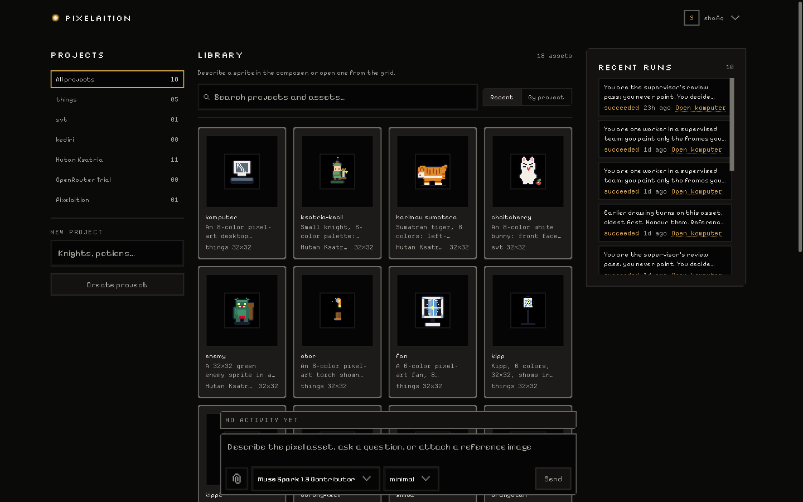
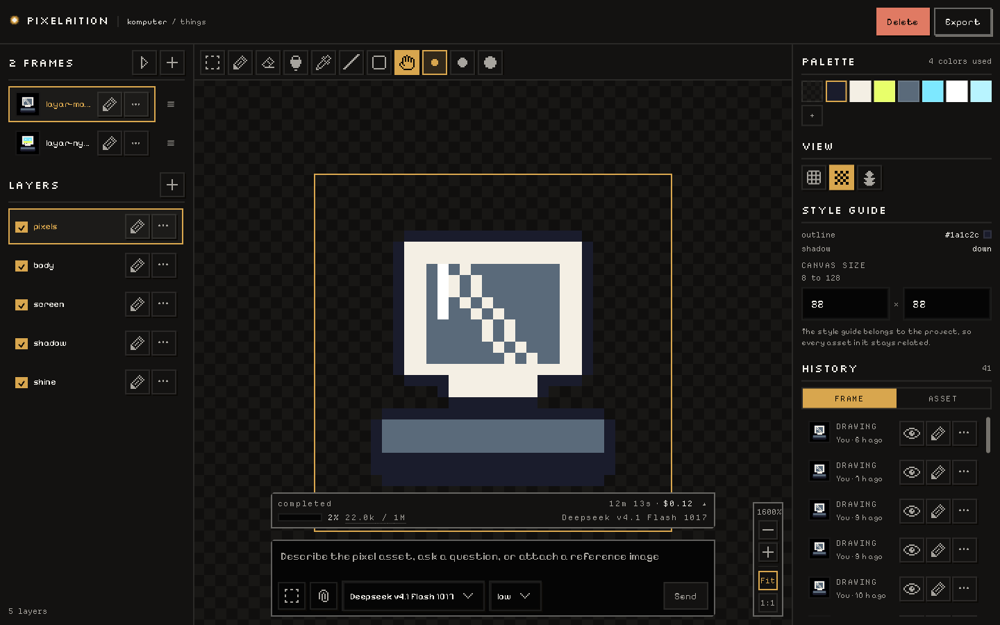
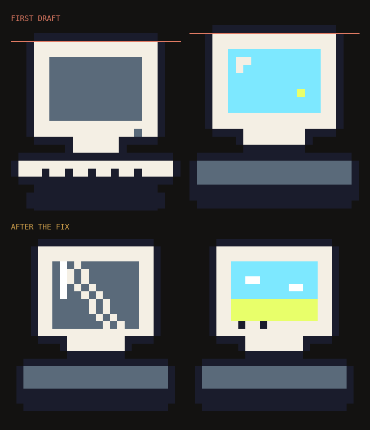
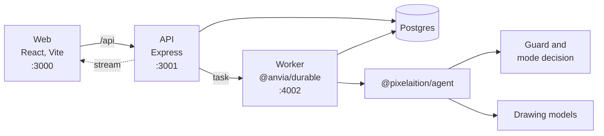

<p align="center">
  
</p>

<h1 align="center">Pixelaition</h1>

<p align="center">
  A pixel-art studio where the agent draws with you.
</p>

<p align="center">
  <a href="LICENSE"></a>
  <a href="https://nodejs.org"></a>
  <a href="https://pnpm.io"></a>
</p>

Pixelaition is a pixel-asset studio. You draw on a canvas, or describe a sprite and watch the pixels appear while an agent works. A project keeps one palette and one style guide, so every asset inside it stays related. A finished asset can grow a new state, such as another facing or another action, from a frame that already exists.

Before any generation starts, a decision layer reads the thread and picks the mode. A drawing run gets painting tools. An answering-only run gets read-only tools. That one call is the difference between the product working and the product politely explaining why it will not.

<p align="center">
  
</p>

## What it does

|                                                                                                                                                                                                                                                                                                                                                                                                  |                                                                                                                                                                                                                                                                                                                                                                         |
| ------------------------------------------------------------------------------------------------------------------------------------------------------------------------------------------------------------------------------------------------------------------------------------------------------------------------------------------------------------------------------------------------ | ----------------------------------------------------------------------------------------------------------------------------------------------------------------------------------------------------------------------------------------------------------------------------------------------------------------------------------------------------------------------- |
|  **A canvas you share with the agent.** Frames, layers, palette and style guide sit around the canvas. A generation streams in as it paints, and every stroke lands through the same edit command the toolbar uses. |  **States that stay related.** Ask for a second frame and the agent builds it from the first one. When it drifts, the frame pair shows exactly where. |

The same screen holds projects, assets, frames, layers and the run history. A composer docks at the bottom of both the workspace and the editor, so a new request and a follow-up are the same motion.

## Quick start

You need Node.js 22.16 or newer, pnpm 10.30.3, and Docker.

```bash
cp .env.example .env
docker compose up --build
```

Open http://localhost:3000, create an account, and start a project.

For day-to-day work, keep Postgres in Docker and run the apps on the host:

```bash
docker compose up -d db
pnpm install
pnpm db:migrate
pnpm dev
```

|        |                       |
| ------ | --------------------- |
| Web    | http://localhost:3000 |
| API    | http://localhost:3001 |
| Worker | http://localhost:4002 |

The web app proxies `/api` to port 3001. One `.env` at the repository root feeds every package through `dotenv-cli`.

### Configuration

Copy `.env.example` and fill the keys for the parts you want running. Manual editing works with none of them.

| Variable                                                              | What it unlocks                                                                                                   |
| --------------------------------------------------------------------- | ----------------------------------------------------------------------------------------------------------------- |
| `AGENT_BASE_URL`, `AGENT_API_KEY`                                     | The drawing models. Point the base URL at any OpenAI-compatible endpoint, such as `https://openrouter.ai/api/v1`. |
| `DECISION_MODEL`, `DECISION_MODEL_BASE_URL`, `DECISION_MODEL_API_KEY` | The decision layer. Required before a run will start. It is a real model call, never a local heuristic.           |
| `DATABASE_URL`                                                        | Postgres. The Compose file already sets it.                                                                       |
| `BETTER_AUTH_SECRET`                                                  | Signed session cookies. Generate one with `openssl rand -base64 32`.                                              |
| `WORKER_INTERNAL_TOKEN`                                               | The API-to-worker handshake.                                                                                      |
| `LANGFUSE_BASE_URL`, `LANGFUSE_PUBLIC_KEY`, `LANGFUSE_SECRET_KEY`     | Traces for every run. Leave them empty to run without telemetry.                                                  |
| `TAVILY_API_KEY`                                                      | Web search. Without it the agent has no search tools.                                                             |
| `EVAL_MODEL`                                                          | The model-judged metrics behind `pnpm eval:judge`.                                                                |

The drawing models and their reasoning efforts live in the `models` table, seeded by migrations. The composer reads them from there, so a model that leaves the seed is deleted by the next migration.

## Architecture



| Package           | Responsibility                                                |
| ----------------- | ------------------------------------------------------------- |
| `packages/pixel`  | The document, the edit commands, the camera and the critique. |
| `packages/export` | `.pxl`, PNG, JPG, SVG and ZIP.                                |
| `packages/agent`  | Tools, decisions, instructions and evals.                     |
| `packages/db`     | The Drizzle schema.                                           |
| `packages/config` | Shared TypeScript and lint configuration.                     |
| `apps/web`        | The editor and the workspace.                                 |
| `apps/api`        | Auth, CRUD, export and the run proxy.                         |
| `apps/worker`     | The durable runtime that owns generation.                     |
| `apps/mcp`        | A stdio MCP server over the same API.                         |

| Layer      | Stack                                                                   |
| ---------- | ----------------------------------------------------------------------- |
| Interface  | React 19, Vite, TanStack Router, TanStack Query, Tailwind CSS 4, Motion |
| Service    | Express, Drizzle, PostgreSQL, Better Auth                               |
| Agent      | Anvia, TypeScript, Zod                                                  |
| Jobs       | `@anvia/durable` on SQLite, one worker process                          |
| Repository | pnpm 10 workspaces, Turborepo, Vitest, Biome                            |

## The agent

One drawing request is one durable `asset-draw` task, and three roles run inside it.

| Role       | What it does                                                                               |
| ---------- | ------------------------------------------------------------------------------------------ |
| Supervisor | Reads the project and writes a plan. The plan card is approved before anything paints.     |
| Workers    | Up to four, each painting its own frames in parallel behind an `allSettled` join.          |
| Review     | Reads every frame, answers with a typed verdict, and decides whether the work is finished. |

There is no round cap in code. Closing the tab does not stop the task. A second request for the same asset answers `RUN_IN_PROGRESS` instead of starting a competing run.

Before any of that, a decision layer reads the whole thread with the project, asset and frames in view, and picks the mode. There is no user-facing toggle for it, and every message passes a guardrail before a run exists.

A wrong verdict is silent. The run succeeds, the UI looks right, and the product quietly does nothing, which is why this layer is measured on its own. `pnpm eval:jev:decisions` runs 30 fixtures three times each through one deterministic metric, with no judge model in the loop. The current score is 90 of 90 verdicts and 30 of 30 stable, against 69 of 90 before the prompt rewrite.

Every agentic case is read back from its Langfuse trace as well. A case without a readable trace is not a passed case.

## Editor

Three columns on a wide screen. Frames and layers on the left, the canvas in the middle, the palette and canvas size on the right. Below 1100px the side columns hide and the canvas plus the composer stay.

| Key | Tool      | Key | Tool       |
| --- | --------- | --- | ---------- |
| `V` | Select    | `G` | Fill       |
| `B` | Pencil    | `I` | Eyedropper |
| `E` | Eraser    | `L` | Line       |
| `R` | Rectangle | `H` | Pan        |

Pan with `H`, the space bar, or the middle button of a drag. `[` and `]` change the brush size. `Escape` drops the selection. Ctrl or Cmd+Z undoes, Ctrl or Cmd+Shift+Z redoes, Ctrl or Cmd+0 fits, and Ctrl or Cmd+1 shows the sprite at one to one. The wheel zooms toward the cursor.

A frame keeps up to four layers. Frames are added, duplicated, renamed and deleted from the left column, and the play button steps through them. Onion skin draws the neighbouring frames underneath the one you are editing, at display opacity only. Drawing is saved 500ms after you stop.

## Export

`POST /api/export` takes a scope of `frame`, `asset` or `project`, then `png`, `jpg`, `svg`, `zip` or `pxl`, at a scale of 1, 2, 4, 8 or 10.

```json
{
  "scope": "asset",
  "projectId": "…",
  "assetId": "…",
  "format": "png",
  "scale": 4
}
```

`.pxl` is JSON and covers a whole project:

```json
{ "format": "pixelaition", "version": 1 }
```

Canvases run from 8 to 128 pixels. Index 0 in the palette is transparent `#00000000`.

## MCP

`apps/mcp` speaks stdio and calls the API with a personal access token. Create one with `POST /api/api-keys` while signed in. The token is shown once.

```json
{
  "mcpServers": {
    "pixelaition": {
      "command": "pnpm",
      "args": ["--filter", "@pixelaition/mcp", "start"],
      "env": {
        "PIXELAITION_API_URL": "http://localhost:3001",
        "PIXELAITION_API_TOKEN": "pxl_..."
      }
    }
  }
}
```

Tools: `list_projects`, `create_project`, `get_project`, `list_assets`, `get_asset`, `create_asset`, `get_frame`, `paint_pixels`, `set_palette`, `create_frame`, `duplicate_frame`, `export_asset`, `export_project`.

`get_frame` returns the frame as rows of palette indexes, with `0` meaning transparent. `paint_pixels` takes palette indexes rather than hex and returns what the server actually committed. Writes go through the same `applyCommand` the editor uses, so a bad coordinate or an index outside the palette is refused instead of stored.

## Development

```bash
pnpm dev                # web, api and worker
pnpm dev:infra          # just Postgres
pnpm build
pnpm typecheck
pnpm lint
pnpm test
pnpm eval               # the agent evals
pnpm eval:jev:decisions # the decision layer, 30 fixtures by 3 runs
pnpm db:migrate
```

`pnpm eval:judge` calls the model-judged metrics (`faithfulness`, `answerRelevancy`, `promptAlignment`, `abstention`, `llmScore`) and needs `AGENT_API_KEY`, because the judge runs on the agent provider.

## Layout

```
apps/
  web/            React editor and workspace
  api/            Express API, auth, export, run proxy
  worker/         the durable runtime
  mcp/            stdio MCP server
packages/
  pixel/          document, commands, camera, critique
  export/         .pxl, PNG, JPG, SVG, ZIP
  agent/          tools, decisions, instructions, evals
  db/             Drizzle schema
docs/images/      the stills in this README
```

Inside `apps/web`, `src/components/ui.tsx` holds the shared controls, `src/components/pixel-canvas.tsx` owns all canvas drawing, and the panels, composer and export dialog live beside them. Screens do not restyle controls themselves.

The worker is the only owner of the Durable SQLite file. Do not run more than one worker replica. It registers one agent per model and reasoning effort from the `models` table, because a Durable submission carries no model controls.

## Contributing

See [CONTRIBUTING.md](CONTRIBUTING.md). Open a branch from `main`, keep the change focused, and say what you ran. Commit messages follow [Conventional Commits](https://www.conventionalcommits.org/).

## License

Pixelaition is open source under the [MIT License](LICENSE).
